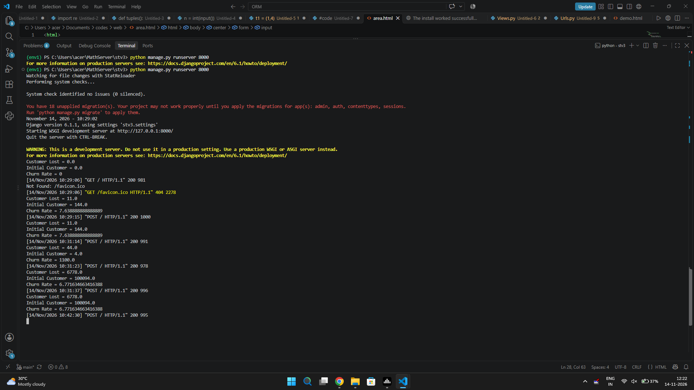
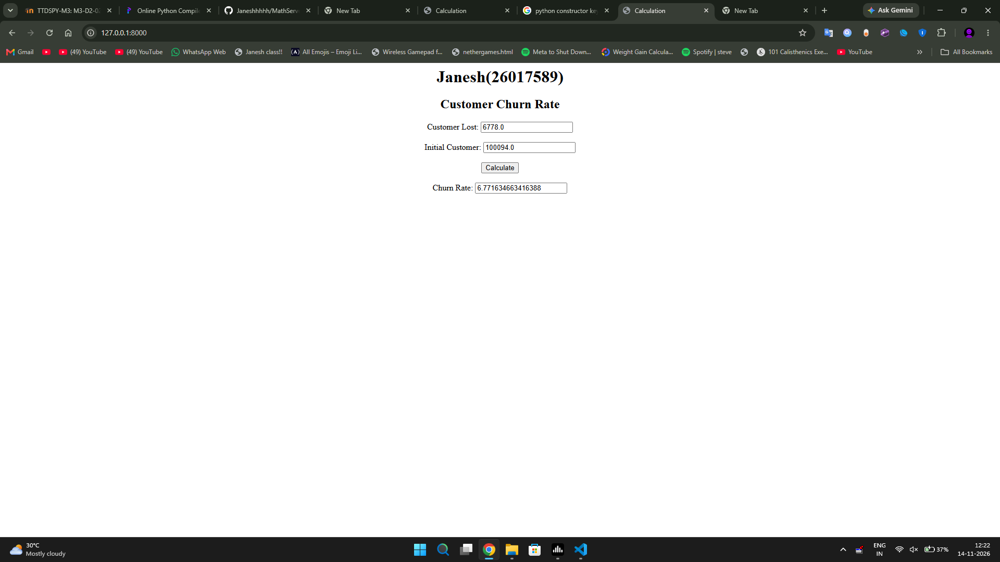

# Ex.03 Design a Website for Server Side Processing
## Date: 14.11.20261

## AIM:
To create a web page to calculate Churn Rate using server-side scripts.

## FORMULA:
Churn Rate = (CustLost / InitCust) * 100
<br> InitCust --> Initial Customers Count
<br> CustLost --> Customers Lost Count

## DESIGN STEPS:

### Step 1:
Clone the repository from GitHub.

### Step 2:
Create Django Admin project.

### Step 3:
Create a New App under the Django Admin project.

### Step 4:
Create a HTML file to implement form based input and output.

### Step 5:
Create python programs for views and urls to perform server side processing.

### Step 6:
Receive input values from the form using request.POST.get().

### Step 7:
Calculate the Result using the given formula.

### Step 8:
Display the calculated result in the server console.

### Step 9:
Render the result to the HTML template.

### Step 10:
Publish the website in Localhost.

## PROGRAM:
```
<html>
    <head>
        <title>Calculation</title>
    </head>
    <body>
        <center>
            <h1>Janesh(26017589)</h1>
            <h2>Customer Churn Rate</h2>

            <form method="POST">
                
                
                <label>Customer Lost:</label>
                <input type="number" value="{{ customerlost }}" name="custLost">
                <br>
                <br>
                
                <label>Initial Customer:</label>
                <input type="number" value="{{ initialcustomer }}" name="initCust">
                <br> 
                <br>
                
                <input type="submit" value="Calculate">
                <br> 
                <br>
                
                <label>Churn Rate:</label>
                <input type="number" value="{{ churn_rate }}">
            </form>
        </center>
    </body>
</html>


views.py
from django.shortcuts import render

def churn_calculator(request):
    customerlost = float(request.POST.get('custLost', '0') or '0')
    initialcustomer = float(request.POST.get('initCust', '0') or '0')

    churn_rate = (customerlost / initialcustomer) * 100 if request.method == 'POST' else 0

    print("Customer Lost =", customerlost)
    print("Initial Customer =", initialcustomer)
    print("Churn Rate =", churn_rate)

    return render(
        request,
        'mojang/area.html',
        {
            'customerlost': customerlost, 
            'initialcustomer': initialcustomer, 
            'churn_rate': churn_rate
        }
    )

urls.py
from django.contrib import admin
from django.urls import path
from mojang import views

urlpatterns = [
    path('', views.churn_calculator, name='churn_calculator'),
]

```


## OUTPUT - SERVER SIDE:




## OUTPUT - WEBPAGE:



## RESULT:
The the web page to calculate Churn Rate using server-side scripts is created successfully.
